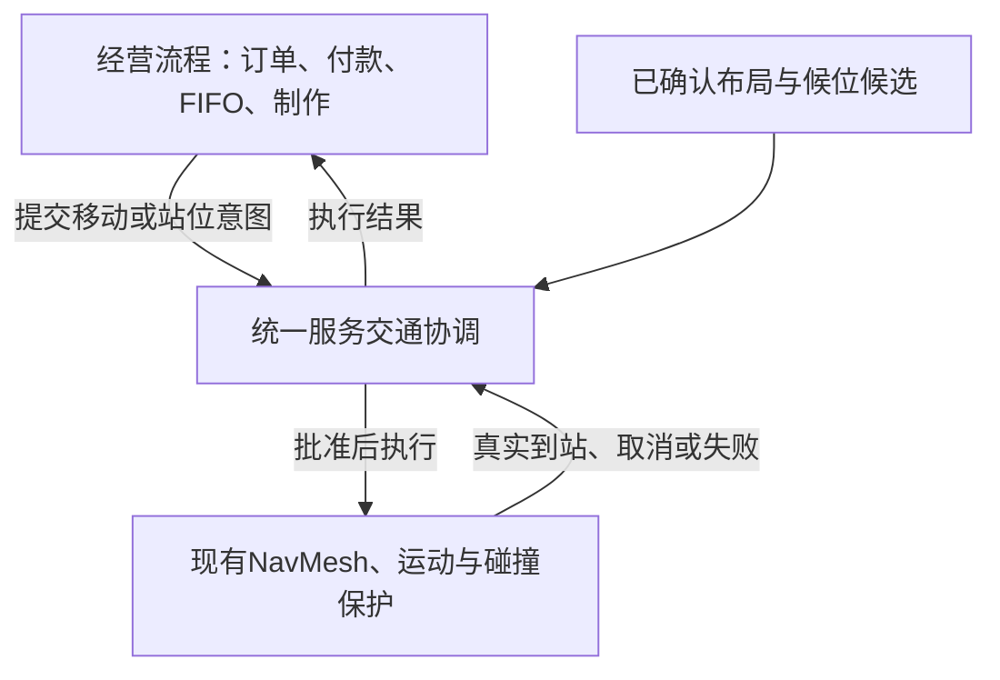

# AnimalCafe 服务交通协调重构设计与 Regression

> 日期：2026-10-30（本地）。状态：**Approved for implementation / 开发及测试已授权。**
>
> Owner在阅读本设计后回复“好的，开发吧，结束了和我说，然后你也可以直接开始测试”，批准本设计的开发及测试。P15仍IN_PROGRESS；修复前Main正常装修经营验收FAIL保留为原始证据。
>
> 本文承接P15已有设计，不另建Phase、不改8小时营业／真实排空后2小时休息、不进入P16。P11–P14共享交通行为的实施步骤见[implementation plan](../plans/2026-10-30-service-traffic-coordination.md)。

## 1. 要解决的玩家问题

玩家正常装修后，咖啡厅应自动接待、收银、制杯、送杯、取餐和离店。普通拥堵由系统安全等待、让行并继续，不能反复要求玩家按Resume维持基本营业。家具真实封路、没有有效设备或身体无法安全离开时，仍明确Blocked；不能穿人、瞬移、销毁重生或假完成。

本次范围先限于**Counter→Pick-up→出口与Barista送杯／返程共享的区域**。全店通用地图求解、离线收益、Save、经济和新员工系统不在本次范围。

### 已证事实与尚未证明的部分

| 类别 | 已有证据／状态 |
| --- | --- |
| 移动边缘 | 合法切向位移被本项目ClampToNavMesh裁掉，已有限定修复及真实边缘／洞／身体反例。 |
| 承诺冲突 | 未发腿、员工余程／返程、实际离店及真实未转移reservation曾分别漏保护，修复入口反复增加。 |
| 到站同步 | 真实Arrived后Presenter平均速度仍非零，曾导致业务到站复核失败；已有Native RED→GREEN。 |
| 搜索与成本 | 真实安全绕行存在而旧搜索返回NULL；补搜索后又出现查询／帧耗时增长，已有缩减但仍有有限成本。 |
| 最新Main | 设备全Ready，Done自动来客，首单Prepared／IncompletePath、Completed0。新站位入口未检查员工既有路线的静态缺口已确认；第二等候点与员工停点间距约0.749，小于安全间距0.911。 |
| 证据缺口 | 最新Main的实际reservation对象、创建顺序和原始内部拒绝predicate没有完整trace。代码缺口＋几何重叠支持互锁解释，**尚不是完整原始因果证明**。 |

依据：[修复历史](../../../outputs/phase15/reservation-rule-20261029-01/report.md)、[Main实测](../../../outputs/phase15/reservation-rule-20261029-01/manual-main-complete/report.md)、[开发前只读调查](../../../outputs/phase15/reservation-rule-20261029-01/manual-main-complete/cause-inspection.md)。历史整个Game无响应已由Owner搁置，首因UNKNOWN，不借本次重构重新立项。

## 2. Approaches 与选择

| 方案 | 收益 | 代价／决定 |
| --- | --- | --- |
| 保留NavMesh，统一服务交通协调 | 复用现有几何、真实运动与碰撞；集中站位、通行权、等待及生命周期规则 | **Owner已选择整理此方向，推荐。** 先迁移Pick-up共享区域，不能只加一个新类却保留两套互相否决的交通政策。 |
| 全面改Grid＋时间预约的多人planner | 更直接表达窄道先后和空间／时间占用 | 仍需业务预留与实际到位同步；重做更多路径合同、运动接线与验证，当前没有足够证据支持该成本。 |
| 以专用通道和更严格布局约束为主 | 降低拥堵组合数量 | 适合作为第一方案的辅助。只采用自动候位约束及必要通路检查，不新增玩家手绘通道工具；完全强制固定摆法会损害装修自由。 |

不采用关闭角色碰撞、缩小角色、无限重试或永久员工优先。真实服务仍以实际到站／交付／取餐／Exit为准；这些约束不是本次被撤销的旧规则。

## 3. 职责划分

- **经营层**保留订单、单次付款、Paid FIFO、制作剩余时间、Prepared／Delivered检查点、容量ledger。它不能因为交通等待重新收费、重制或伪造完成。
- **交通层**统一批准站位、已选路线和必要瓶颈通行，管理等待依赖和权利退休。规则按owner／意图／先后顺序执行，对顾客与员工对称。
- **几何查询层**继续使用本adapter拥有的NavMesh、同Filter和现有完整路径／精确终点要求。NULL或预算不足不等于已证明数学上无路。
- **运动层**继续是身体位置的唯一写入者，逐步做真实碰撞保护；交通批准不能绕过它。NavMeshMovementDriver与NavigationWorld的底层行为不在初始重构范围。
- **表现层**只显示实际结果；动画速度不决定订单能否完成。真实Arrived仍需绑定正确Actor／request／generation／layout，展示事件异常不能吞掉合法终结事件。

协调器拟为普通C#对象，由当前CafeLoop运行上下文持有，非跨Scene static singleton；不新增必须手工接线的MonoBehaviour。仅P14/P15 integrated模式启用，P11/P12及P13独立验证保留原兼容入口。

## 4. 一个空间承诺入口

### 4.1 意图、权利和真实占用

每个意图至少关联ActorId、稳定IntentId、业务上下文标识、generation、layout revision和稳定取得序号。业务上下文只用于身份核验，不把Order状态机搬进交通层。分腿和Native request ID变化不能让同一意图重新取得更早优先级。

统一登记三种不同事实：

| 事实 | 含义／释放条件 |
| --- | --- |
| 真实身体占用 | 包括仍存在的disabled身体；必须真实移动／按既有生命周期销毁后才不再挡路。取消请求不删除身体。 |
| 停车／服务侧承诺 | 真实reservation或service lease；以原Queue／lease owner和generation为依据，路径缓存失效不等于位置已释放。 |
| 已选旅程与当前通行权 | 记录真实选定的送杯余程／返程、取餐／离店余程；只退休实际走完的腿。取消、完成或换代退休旧移动权利，仍保留上述身体与业务占用。 |

PickupQueueService仍是reservation目标与Paid FIFO的canonical owner；CapacityService仍是容量owner。协调器拥有**空间许可**，引用这些owner的身份与版本，不建立第二套可独立分配的Queue或容量账本。

### 4.2 新承诺必须在发布之前检查

一次新站位／服务侧／移动许可采用“准备候选→检查全体既有有效承诺→核验版本→共同提交→发布事件”。准备失败、UNKNOWN、版本变化或提交失败，均不留下半个reservation、Actor、付款、订单或token。

对Queue变更与交通登记的共同提交采用单一同步入口，无await／外部回调夹在中间；两者都成功前不发布可重入事件。失败必须按原owner回滚一次，不能释放别人的位置。独立旧Queue单元测试可以保留，但integrated生产入口不得绕过协调器。

必须涵盖入店、首次取餐预留、已有预留重验证、付款后转队、队伍前移、多侧领取、送杯、返程、真实离店首次规划／等待后发腿／有界replan及让位恢复。禁止只补某一入口而遗漏同一意图的另一发腿入口。

## 5. 等候区与瓶颈政策

1. 沿用既有候位生成器提供候选和自然单列顺序；协调器决定哪些候选可被承诺。以真实可用链长限流，不提高原容量上限，不替已付款顾客腾空其reservation。
2. 在有效工作站组合上，先证明至少一个送杯／返程组合、顾客服务接入和出口通路，再逐个加入候位。新候位不能破坏这一基础服务能力，也不能覆盖先有有效员工或顾客路线。
3. 这是一项布局／停车能力检查，**不是提前独占尚未选择的未来出口路线**。优先尝试既有合法备用侧和可行绕行，不能把一条最短路永久划成全店禁区。
4. 已选员工送杯余程及返程需要防止被长期停车目标封住；这不等于整段未来路线永久禁止别人短暂穿行。实际移动互斥只覆盖当前冲突段、服务侧和必要瓶颈；可独立有限完成的短暂穿行由调度安排先后。
5. 窄道按当前可安全通过的方向授权。进入前必须有安全可到达的终点／等待位置及后续释放依据，不能仅锁下一小段就把角色送进没有退路的空间。不同合法服务侧且路径不冲突时，仍应允许原多侧并行。
6. 使用现有身体尺寸、collision skin、用途对应的间距与到站容差，不借本次设计缩小碰撞或统一调大epsilon。新候位不足时减少可接待人数；若连一套服务都无法运行，明确配置原因。
7. 规则自动从当前已确认布局与已选服务组合派生，不新增serialized区块、手绘通道、Scene资产或存档字段。未来如确实需要这些内容，另提设计。

Ready只能表示当前配置检查通过。它不承诺任意未来拥堵都不会发生；动态冲突必须由同一交通层管理，不能仍由各controller各自决定。

## 6. 等待、优先、公平与真正失败

交通结果与底层NavigationFailure分开，拟用以下高层结果；名称可在implementation plan中调整，语义不可合并：

| 结果 | 行为 |
| --- | --- |
| Granted | 提交许可后才发原Navigation请求；发腿仍从实际位置检查。 |
| WaitingForTraffic | 明确列出阻挡owner及其当前可独立有限推进的工作／路线。原任务、Prepared杯、付款、FIFO与容量保留。 |
| DeferredByBudget | 本次规划工作尚未完成；不授予许可、不新增业务事实，继续同一有界决策工作，不每帧重开整轮搜索。 |
| Unreachable / InvalidConfiguration | 静态拓扑或必要工作配置已明确不满足；准确显示原因，沿用真实Blocked与显式修复恢复。 |
| PlanningFailed / InvalidStart / Cancelled / StaleContext | 分别保留规划失败、真实起点问题、正常取消及过期上下文；不能统统标为Native IncompletePath。 |

### 6.1 等待必须能结束

- 先取得**有效承诺**者优先；不按Employee／Customer设永久特权，不按新的Native request ID重排年龄。
- 等待图记录“谁依赖谁释放哪项资源”。只允许依赖能够独立有限推进的owner；禁止授予会闭环的新许可。新候选被拒绝时保留原业务与身体，不能把该候选发布成另一个阻挡owner。
- 若现实身体／旧承诺已形成无安全让行路径的环，显示具体Blocked依赖；不声称一个新调度器能自动解决任意封闭布局。
- 同一可授予资源按稳定请求顺序处理，平局按稳定ActorId。后来的请求不能无限插队。公平性只在前序确实可完成且路线持续可行的前提下承诺；玩家Pause或永久堵路不算公平失效。
- 只在真实释放、任务阶段结束、取消／停用、实际Arrived、布局变更等相关事件后唤醒受影响的waiter；无变化时不重复昂贵规划。持续的普通行走不触发全员重规划。
- 等待依据与owner的原有有限制作／导航／恢复边界绑定，冻结本次依赖集合及等待预算。分腿、换request和新来客不能重置预算或不断延长依赖链。预算耗尽后明确失败，不以新的Intent包装成无限重试。
- Owner 2026-11-04批准的入口 readiness：只对尚未出生、尚未获权的原 admission proposal，若其真实已规划首段会侵入合法已取餐 actual-exit 的固定出口终点 clearance，则有限暂缓原准备。已Bound但尚未真实离店仍保护原固定出口；不按任意Exiting全局锁店，不独占整条future suffix，不给未出生者伪造body/claim或添加Frozen依赖。暂停、Ready、Prepared刷新及共同提交均遵守同一原descriptor；解除只重新排队并完整核验。首次沿原FiniteSeconds/waitSeconds初始化一次累计等待，已消耗的hold与普通WAIT共享原剩余额，超时明确失败，不重置key/年龄/query/预算。实现与限定回归见 `2026-11-04-admission-exit-readiness.md` 及批准的 photo-pickup 提案。
- 游戏Pause不消耗等待／运动预算，不以现实时间让有效通行权过期；2x只按现有游戏时间缩放一次。P15现实营业deadline继续按原规则走。
- 普通交通Waiting在真实腾空后自动继续；已发出导航的真正失败仍走原一次有界replan／recovery，不自动重试真正Blocked。

### 6.2 局部故障

只停止依赖受阻资源的新接待或服务，让其他独立且有效的工作继续。共享唯一Barista／唯一出口失效时，相关服务链无法推进属于真实限制，不能伪造其他订单完成。Closing不新增顾客，但保留有效送杯、取餐、返程、离店意图直到真实排空。

## 7. 生命周期和排空

- 每个回调与空间权利核验Actor、Intent、generation、layout revision、业务上下文；退休与回滚幂等，旧回调不能复活旧许可。
- 实际Arrived仅退休已走腿；下一腿从实际位置核验。视觉展示、规划成功或移动被接受，都不算实际到位。
- Cancel／disable／destroy区分处理：撤销失效移动及相关等待依赖；仍在Scene中的身体和仍存在的canonical停车事实继续挡路。能否重用旧任务按原checkpoint规则决定。
- Decor只查看／取消Preview不改变旧业务或通行权；真实Confirm按原P14规则退休旧epoch，记录一次LayoutInterrupted。保留已取餐仍离店顾客的身份、身体、杯和Total，并从实际位置为新layout建立有效离店意图。
- P15 drain增加对交通pending决策／活动grant／相关回调的核对，不能只看“没有人在动”。真实订单、杯、顾客、Counter／Pickup、三类容量、员工回岗等原检查全部保留。没有剩余工作的idle缓存不得永久阻止Rest。
- 协调器关闭／Scene卸载先退休上下文，再处理可重入终结事件；重新打开Scene不得继承旧static权利。

## 8. 性能与诊断

- 静态几何／候位能力结果可按layout与服务组合版本缓存。动态通行许可不能跨真实位置或owner变化盲目复用；提交前重验相关版本和实际起点，运动时继续全碰撞保护。
- 每个决策批次和每帧共享查询预算；预算不足返回Deferred，不放行UNKNOWN。目标是减少重复完整Native查询，不能以提高旧4000查询上限或放宽保护换通过。
- 等待时只维护依赖和事件队列。缓存过期不得每帧重建完整A*图；相关事件可启动新的有界工作，但同一未完成意图保留原预算和年龄。
- 性能基线固定源码、布局、速度及是否开启观察；记录Native查询量、协调耗时、P95/P99帧时间、最长帧及>500ms次数。Editor批次总用时和测试IO不冒充产品CPU耗时。
- implementation plan须在同机基线测量后写明决策／帧预算与允许退化阈值；这些是由工程选定的参数，不能留到验收失败后调大。移动端性能仍需device验证，Editor不替代。
- 默认关闭重型trace；保留小型有界原始决策历史，失败时一次性输出reason、owner、Intent、资源、route suffix、layout及实际拒绝层，明确overflow／NOT_EVALUATED。事后重复查询只能称探针，不能冒充原判定。
- Main继续使用正式玩家UI，显示可理解的等待／封路原因；详细资源图与内部ID留在Validation／Editor，不恢复Main黑色调试HUD。

## 9. 拟影响文件和兼容边界

以下是设计时的实施候选清单；Owner现已授权开发及测试。确切signature、selector和当前验证状态以[implementation plan](../plans/2026-10-30-service-traffic-coordination.md)及对应执行记录为准，不能从文件已创建推断功能已验收。

| 文件／系统 | 拟用途 |
| --- | --- |
| 新`Assets/Scripts/Navigation/ServiceTrafficContracts.cs` | 稳定意图身份、claim引用、typed决策及等待原因；不扩写底层NavigationFailure业务含义。 |
| 新`Assets/Scripts/Navigation/ServiceTrafficCoordinator.cs` | 共享空间许可、事务提交、候位准入、稳定优先、等待图和生命周期；复用现有只读Native路径查询与planner。 |
| `Customers/CustomerFlowController.cs` | 各顾客入口改为同一交通申请／执行结果，迁出重复交通政策；保留Visit/FIFO/真实移动与已批准业务。 |
| `Customers/PickupQueueService.cs` | 共同提交准备／回滚及canonical owner校验；保留Paid FIFO、真实reservation与服务侧语义。 |
| `Employees/EmployeeFlowController.cs`、`EmployeeTaskRunner.cs` | 员工送杯／返程使用相同许可，区分等待与运动失败；保留checkpoint与真实Arrived。 |
| `CafeLoop/CafeLoopController.cs` | 持有运行时协调器，统一事务／结果与drain接线；不重写Order／Capacity ledger。 |
| `Navigation/NavigationLayoutAdapter.cs` | 如确有必要，只读导出现有布局／拓扑能力；不改变Filter、采样、Bake或底层移动。 |
| 正式UI状态映射及P15 drain tests | 正确显示Waiting／Blocked、核对新pending；拟复用`CafeLoopStatusView`、`ValidationMessageView`、`BusinessDayStatusView`，不改时钟逻辑。 |
| 新Edit `ServiceTrafficCoordinatorTests.cs`、新Play `CafeServiceTrafficTests.cs`及现有相关tests | 新契约、Main原故障、跨入口集成；复用既有fixture，避免继续把全部新测试堆进4074行的长柜台文件。 |

默认保留NavMeshMovementDriver、NavigationWorld、NavigationService的物理／恢复合同及模型／半径／Scene／Prefab／GUID／营业时长。若诊断证明必须改变这些边界，先说明新证据并单独确认，不将其隐藏在重构中。

空间权利是运行时派生数据，不持久化。现有家具数据和Scene不用迁移；若实现需要serialized接线或新存档字段，视为范围变更。既有布局可能减少安全候位，必须明示原因，不移动／删除家具、不清除有效已付款reservation来迎合新策略。旧P11/P12/P13独立Scene继续可用。

## 10. 迁移顺序与停止条件

1. **先补当前Main原始证据。** 保存已有现场与布局后，用同一摆法和真实顾客捕获第二reservation及员工下一腿的原判定，形成可信Native反例；fixture／编译／日志错误不得当产品RED。若反例指向其他原因，先修正诊断，不为猜测写产品补丁。
2. **先验证统一合同，再接一个入口。** 新协调器先做角色对称／事务／等待／退休测试；接入取餐新站位和员工已选旅程，原业务断言保持。新旧政策不能同时是某一入口的批准者；测试用对照观察可以保留，生产只执行一次决定。
3. **逐个迁移其余共享入口。** 前移、转队、多侧、实际离店、返程、pending／replan及让位恢复全部通过同一入口；删除被替代的旧政策分支，保留运动最终安全门禁。每步跑focused＋直接相关regression，出现新的越界风险先停该步。
4. **最后集中验收。** 统一源码后跑本节R01–R20及manual，再按项目流程做完整EditMode／PlayMode与必要部门review。只有有新代码／新失败／未解决疑点时扩大或重跑；docs-only不启动Unity。

这是设计里的迁移约束，**不是已批准implementation plan**。没有可信反例不修改产品迎合fixture；没有统一入口覆盖不宣布重构完成；失败不得靠删除旧业务断言或放宽碰撞／deadline解决。

## 11. Regression清单：自动与Native

Regression指“修改交通机制后，确认已做好的功能仍保持正确”。下表是**20组验收责任，不是承诺只有20个NUnit case**；参数化展开、FQN与实际counts在实施计划和XML中确定。新增组当前全部NOT_RUN，旧源码PASS不得填成本设计的通过结果。

路径缩写：`E11`等表示`Assets/Tests/EditMode/Phase11/`，`P11`等表示`Assets/Tests/PlayMode/EditorSceneLoading/Phase11/`；P12–P15同理。`NavigationMovementTests`在P11，布局接线另含`EditorSceneLoading/NavigationLayoutIntegrationTests.cs`。

| ID／范围 | 必测正例、反例和不变量 | 现有基础／新增内容 |
| --- | --- | --- |
| R01 几何与连续碰撞 | 1m通道通过、0.85m失败；不穿墙／人；交叉sweep不交换身体；真实边缘／洞／partial负例仍拒绝 | E11 `NavigationCollisionTests`；P11 `NavigationMovementTests`；旧`BoundaryTangentRetainsNativeEdgeHoleAndBodyGuards`。新增“取得交通许可也不能绕过sweep”。 |
| R02 统一角色与入口 | customer→employee、employee→customer两向；admission／新站位／转队／前移／送杯／返程／实际exit／pending／replan均受同一许可约束 | 复用P14实际员工／离店保护测试；新增角色交换及全部入口契约测试，不能只测一个public方法。 |
| R03 事务与重入 | 准备失败／UNKNOWN／版本改变不发布Actor、Queue目标、付款、Order或token；提交失败各owner只回滚一次；回调重入不半提交 | E12 `CustomerAdmissionTests.FailedPreparationRollsBackAllThreeReservationsExactlyOnce`；E14 `PickupQueueTests`；新增跨Queue＋traffic共同提交失败／重入。 |
| R04 真实预留保护 | 未付款但有效的reservation仍被保护；路径cache失效不删位置；不能新建目标覆盖先有员工或顾客余程／返程 | 旧`UntransferredPickupTargetSurvivesFailedPathRevalidationUntilRealRelease`、`CanonicalPickupGoalBudgetUnknownCreatesNoCommitAndRealOwnerRemovalClearsIt`；新增员工路线被后客预留覆盖反例。 |
| R05 稳定优先与公平 | 同帧稳定平局；跨leg／replan不重排意图年龄；无年轻请求插队；可行且前序完成时等待者真实通过 | 新Coordinator单元／Native tests；不以不同Native request编号判断谁先取得业务权利。 |
| R06 循环等待与出口安全 | 两人／三人等待环拒绝新授权；下一段可走但无安全落脚／后续释放依据时不送入瓶颈；现存不可解环明确Blocked | 新图／Native tests；保留旧静态堵路反测。不能以无限WAIT或提前释放身体／token通过。 |
| R07 Waiting／唤醒 | 普通拥堵不直接变真正Blocked；实际腾空自动继续同一任务；无关事件不发request；无变化不反复做昂贵Native查询；预算不因换request重置 | 新Coordinator事件／预算tests＋旧pending／finite traffic tests。静态／disabled永久障碍不能冒充有限traffic。 |
| R08 真实导航失败与恢复 | 原一次有界replan；Recovered不冒充Arrived／Delivered；InvalidStart不瞬移；Blocked仍显式恢复；等待前后的几何保护一致 | E11 `NavigationServiceTests.RetriesOnceFromLatestPosition`／`RecoveryIsNotArrival`；P11 disabled body tests；P14 `CafeEmployeeRecoveryTests`。 |
| R09 身份与退休 | 完成／取消／disable／destroy／owner replacement／layout换代拒绝旧claim与callback；Arrived只退休已走腿；仍存在身体仍阻挡 | E11 `OldGenerationIsIgnored`；E12 session；E13 lifecycle；旧`OwnedStaffDeliverySuffixRetiresAfterRealArrivalAndCompletion`及Cancel／LayoutChange；新增统一账本退休／重入。 |
| R10 员工制作与到站 | Prepared等待不重做制作、不丢手杯；正确真实Arrived才交付；真实返岗才Idle；展示异常／disable不复活完成 | E13 `EmployeeTaskRunnerTests`；P13 `EmployeeFlowTests`；旧`NativeEmployeeArrivalCallbackPublishesStoppedMotion`及Disable／SubscriberFailure控制例。 |
| R11 付款、FIFO与容量 | 一次付款／订单；只允许Paid队首取自己的杯；实际Exit才释放Total；所有拒绝／等待不重复扣费或释放他人token | E9/E10/E14 order／capacity／queue；P14 `OneSecondCashierOwnerPauseFastAndRecreatedRunnerKeepOnePayment`、`CompletesTwentyRealOrdersAndDrainsAllCapacityAtOneX/TwoX`。 |
| R12 多侧、候位与展示 | 同侧互斥；合法备用侧；员工占一侧不妨碍另一合法侧领取；自然单列、朝向、队尾与实际容量；最多3可见杯、手杯和Order ownership不变 | E14 `PickupSingleFilePlannerTests`／`PickupSidesTests`／`PickupQueueTests`；P14 `CafePickupSideTests`／`CafeCustomerCarryTests`。新增候位不覆盖必要通道及有效备用路。 |
| R13 装修与新epoch | 取消Preview保留原业务；真实Confirm只记录一次LayoutInterrupted、退休旧权利；保留已取餐仍离店顾客及Total；同一员工从实际位置回位 | E14 decoration/checkpoint；P13 `EmployeeDecorationTests`；P14 `CafeDecorationFlowTests.NoChangeAndCancelledPreviewPreserveOrderAndCheckpoint`及实际Carry/Exit变体。 |
| R14 时钟、Pause与排空 | 正式28800／7200不变；1x／2x／Pause只作用Scene工作；Pause不失去通行权；Closing继续排空；pending交通、返回员工及真实Exit均阻止过早Rest | E15 service/drain；P15 `BusinessDayIntegrationTests`／Admission；新增交通pending及无工作idle缓存的drain正反例。 |
| R15 旧布局与吞吐 | 原UserLongCounter6/7及Photo6/7×1x/2x八组各20真实Exit；原中央柜台两档60真实Exit；counter corner／single side／rotations矩阵 | P14 `CafeLongCounterStallTests.cs`及`CafeFurnitureLayoutMatrixTests.cs`中真实cases。新的候位政策可改变链长，但须逐项说明并保留FIFO、付款、碰撞和真实排空断言。 |
| R16 最新Main同摆法 | 保留原始故障Native RED；真实新reservation时序、员工route suffix、下一腿原predicate有记录；修后首单和后续订单真实完成并Exit | **新增**同布局Native case；不手设Arrived／付款／完成，不能只跑预置Validation布局，也不能用事后重查替代原决定。 |
| R17 扩展布局与时序 | 首批12个固定、可重放seed，覆盖不同柜台尺寸／旋转、墙角、窄道、来客时机；明确可营业或应拒绝的预期；失败可缩减为小反例 | 新Native数据驱动tests。fixture分类独立审查，不能以新代码给出的Ready结果给自己贴PASS；真正封闭布局正确拒绝也算通过。 |
| R18 长时自动经营 | 稳定Main至少15现实分钟连续可推进观察、1x/2x均覆盖；短时Validation至少10现实分钟跨Closing／Rest／自动重开；无工具注入／恢复调用掩盖自然停滞 | 复用中央柜台及真实时钟acceptance fixture；新增Main长时。记录暂停／菜单时段，不能把它们算作连续活跃经营；失败保留原现场。 |
| R19 性能与证据 | 同源码／布局比较查询量与协调CPU、P95/P99／最长帧／>500ms；预算耗尽不放行；等待无重复搜索；trace overflow及observer错误如实报告 | 原PhotoSix safe-detour及covered-end测试／成本记录；新增协调预算与事件唤醒成本。性能阈值先在实施计划定，不用Editor总耗时冒充产品CPU。 |
| R20 Main/UI／旧Scene／资源 | Main原始不完整配置拒绝接待；正常目录布置后自动营业；Main无黑HUD；横竖屏提示可读；P11/P12/P13独立Scene兼容；Scene／Prefab／meta不被测试意外写坏 | P15 `BusinessDayMainSceneTests`／UiScene；旧legacy fixtures／P6/P7安全写入回归。完整Edit/Play在最终集中收尾，不每步全跑。 |

**Selector注意：** `CafeLongCounterStallTests.cs`、`CafePickupExitTrafficTests.cs`与`CafePickupSideDeliveryTrafficTests.cs`实际是`AnimalCafe.Tests.PlayMode.Phase14.CafePickupSideTests`的partial文件。按真实class／method及XML选择，不能按文件名拼FQN。现有`MainUsesFormalCycleAndOriginalUnreadyLayoutRejectsWithoutAllocation`只覆盖不完整Main拒绝分配，不等于正常装修后经营已覆盖。

旧相关Edit387PASS／Play299PASS＋6明确opt-in SKIP仅为CFC C8F521／EFC71744D等旧冻结源及既定输入的证据。实施后必须产出新源结果；不预填新counts，不把SKIP／INCONCLUSIVE／harness失败改为PASS，不因默认suite未执行opt-in真实时间case就当该责任已验证。

## 12. Manual / Computer Use验收

这7项是未来重构的验收操作，**当前全部NOT_RUN**；不重命名或覆盖原P15-M01–M07历史记录。Agent可代做客观操作，Owner保留界面观感／设备接受。

| ID | 操作 | 预期与记录 |
| --- | --- | --- |
| TM01 正常Main全流程 | 原始Main→Play→Decor，用目录滚动、摆CR／Counter／CM／Pick-up并逐件确认→Done | 不用seed／API注入；自动经营，记录首单及至少20次真实Exit。取餐和返程能继续，Console无未处理产品error。 |
| TM02 原失败摆法 | 重建本次Main摆法，保持1x，观察第二顾客到达、取餐预留与员工送杯；再2x复看 | 若新候位不安全，应等待或选合法候位，不能全Ready后首单互锁；需原始trace支持Native结论。 |
| TM03 拥堵与多侧 | 使用窄道／单侧和合法多侧两种已review布局，正常自动来客 | 普通拥堵自动让行并继续；多侧合法并行仍可用；不穿人、无无限原地Walk、不要求手点Resume。 |
| TM04 真正封路 | 单独受控场景注入真实blocker→观察Blocked→修复→显式恢复 | 提示具体、原订单／杯／付款保留；恢复后真实到位／Exit。与TM03普通等待及TM07健康窗口分开。 |
| TM05 装修与Pause | 取消Preview一次；真实Confirm一次；分别在工作／等待／返回时用游戏HUD Pause、1x、2x | 取消不丢任务，真实修改只中断一次，权利退休正确，Pause不使角色继续运动或按墙钟丢失权利，恢复后自动推进。 |
| TM06 营业周期与UI | Validation观察Open→Closing→真实排空→Rest→自动Open；Main核对正式时长、横竖屏、正式提示 | 无Start／Next Day；交通pending不能假排空，空闲缓存不挂住Rest；Main无黑HUD，按钮与长原因可读。 |
| TM07 长时健康窗口 | 稳定Main至少15现实分钟，1x/2x均有经营；Validation至少10分钟跨日；窗口内不放blocker、不调用恢复 | 记录实际订单和Exit集合、起止时间与控制操作；自动持续经营、实际Rest排空及重开，原source／Scene保持。暂停／菜单区间另记，不能只凭“人物在动”PASS。 |

真实8小时＋Closing＋2小时、Windows Player、Android/iOS设备、应用挂起／退出恢复仍单列NOT_RUN及后续平台验收；不得用本轮短窗口宣称已覆盖。未来Save／Offline要复用有效布局能力和业务状态，不能要求后台逐帧模拟每位NPC，本次不实现该系统。

## 13. 风险、验收与下一步

主要风险是重复权力未迁干净、过度锁住未来路径导致低吞吐、取消后漏释放或误释放、等待关系过期／饥饿、保守候位过少、动态查询造成性能退化，以及新drain把idle缓存当活动业务。R01–R20分别覆盖安全、活性、业务事实和成本，不能只以固定摆法不再停住作为验收。

完成要求：所有目标入口只执行一个政策；新Main可信反例修后通过；旧业务不变量与必需布局／长时／性能责任通过；无Critical／Important；新源完整EditMode／PlayMode集中通过；manual与Owner／device／CI／merge按各自范围如实记录。真实无路允许明确Blocked，**不承诺任意摆法永不堵塞**。

Owner已确认开发及测试，当前按[implementation plan](../plans/2026-10-30-service-traffic-coordination.md)实施。新源结果逐项记录；不commit／push／merge。

### 文档review记录（不等于运行验证）

- QA只读核对了现有测试文件、代表case和partial class selector，列入R01–R20；确认旧Main自动case缺少完整目录装修后的经营链覆盖。
- 独立fresh builder check阅读本文及相关实现后返回`nothing important left`，未提出阻止制定实施计划的问题。这是可规划性检查，不是设计批准、代码review、Native RED或regression PASS。
- 工程自检补充了停车目标与短暂穿行的区别、Queue canonical owner与空间许可的分工、原子提交／重入、暂停不失权及drain空闲缓存的正反例，防止只把旧条件搬进新类。
- 本文所有新增测试与未来重构验收仍为NOT_RUN；当前Main原始内部拒绝predicate及reservation时序仍待诊断，不升级为已证明。
